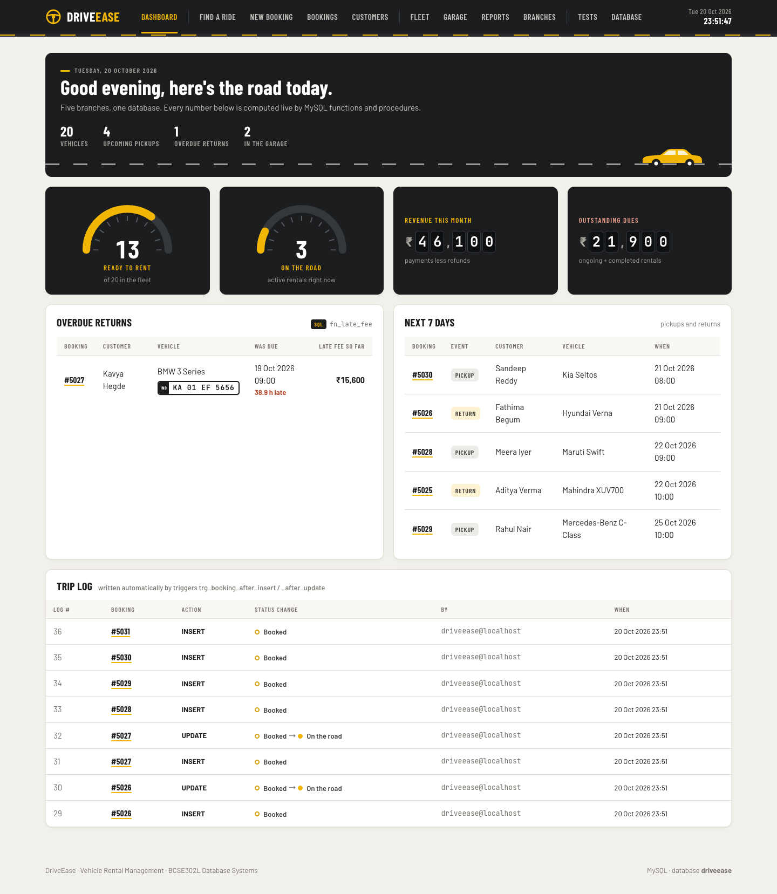
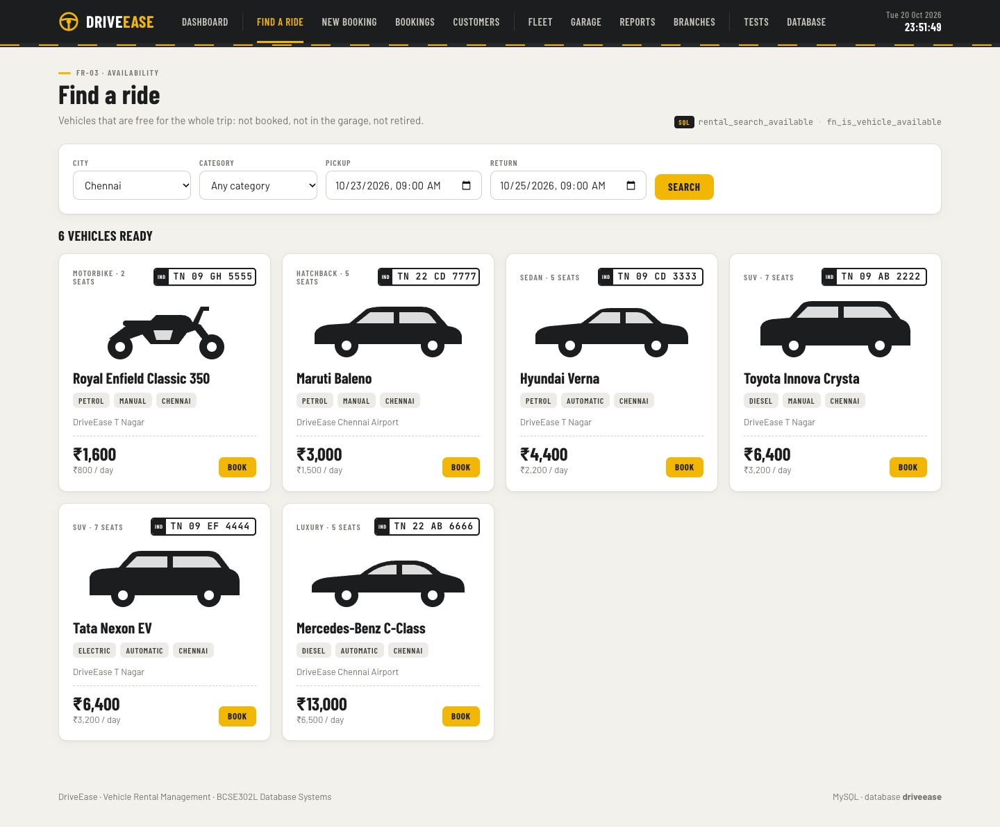
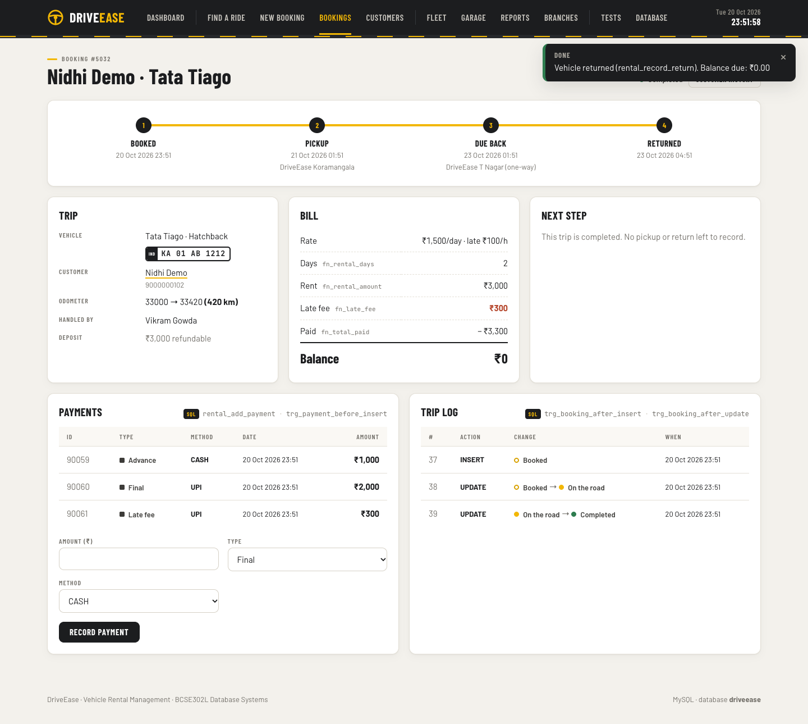
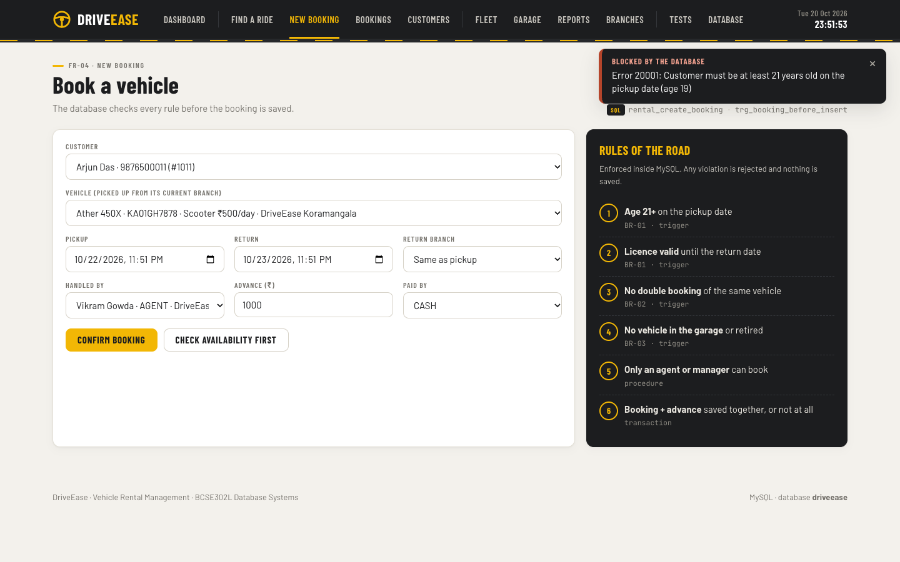
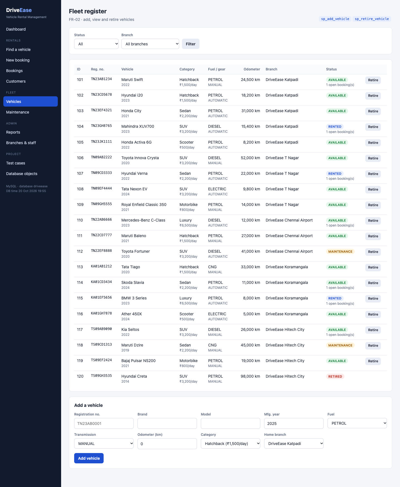
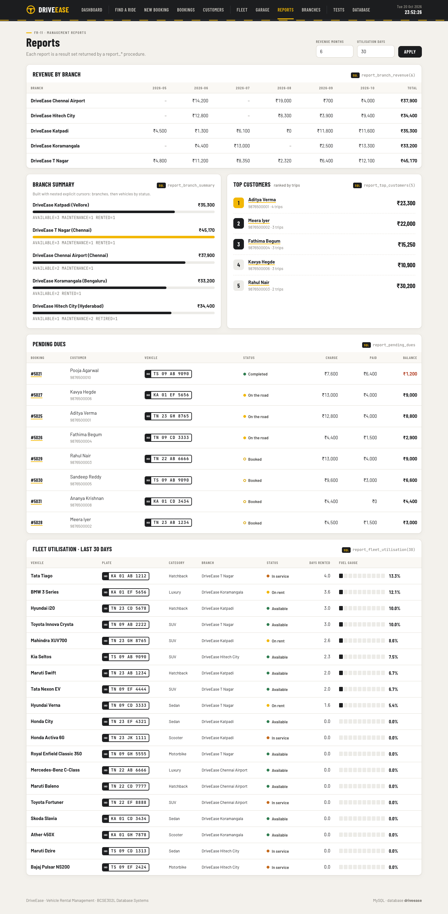
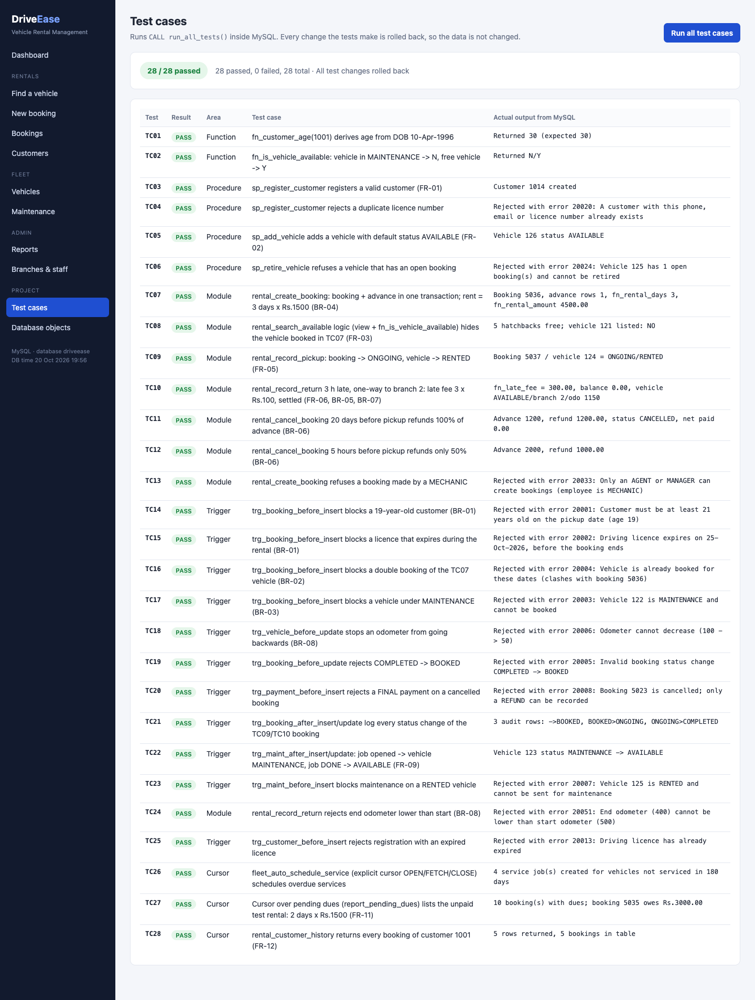
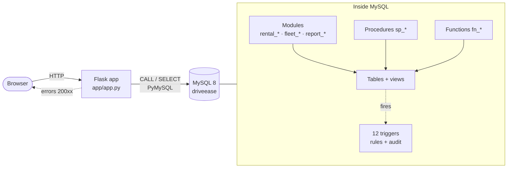
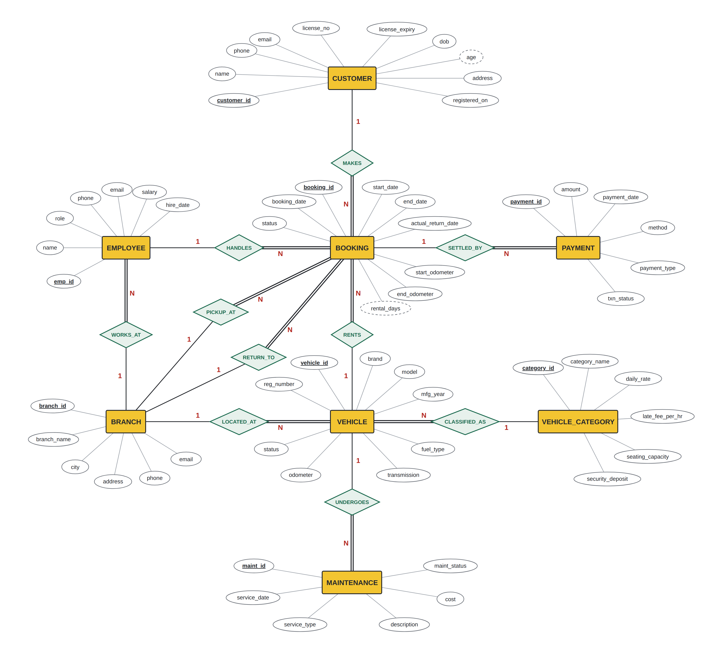

<div align="center">

# 🚗 DriveEase

### Vehicle Rental Management System

A multi-branch car and bike rental database built on **MySQL 8**. Business rules are enforced inside the database by stored functions, procedures, modules, triggers and cursors, and a **Flask** web front-end calls them directly.

[](https://github.com/sanjay7978/DriveEase/actions/workflows/ci.yml)




</div>

---

## Contents
- [Highlights](#highlights)
- [Tech stack and skills](#tech-stack-and-skills)
- [Screenshots](#screenshots)
- [Architecture](#architecture)
- [Database design](#database-design)
- [Getting started](#getting-started)
- [Database objects](#database-objects)
- [Testing](#testing)
- [Project structure](#project-structure)
- [Team](#team)

## Highlights

| | |
|---|---|
| 🗄️ **9 tables**, 3NF | Branch, category, vehicle, customer, employee, booking, payment, maintenance and a booking audit trail, with keys and CHECK constraints |
| ⚙️ **7 functions** | Age, rental days, rent, late fee, amount paid, balance due and vehicle availability |
| 🧩 **6 procedures + 16 module routines** | `rental_*`, `fleet_*` and `report_*` modules, MySQL's equivalent of Oracle packages |
| 🛡️ **12 triggers** | Age ≥ 21, valid licence, no double booking, no rental of a vehicle in the garage, odometer never goes back, automatic audit trail |
| 🔁 **Explicit and nested cursors** | Automatic service scheduling, customer history and branch summary reports |
| ✅ **28 automated test cases** | `CALL run_all_tests();` checks every object and rolls back its own changes |
| 🌐 **Web front-end** | 11 pages where every action is a stored-routine call, and database errors appear as clear messages |
| 🔒 **Atomic transactions** | Multi-step procedures commit together or roll back together, using savepoints when the caller already has a transaction open |

## Tech stack and skills

| Area | Used in this project |
|---|---|
| **Database** | MySQL 8 · InnoDB · AUTO_INCREMENT keys · CHECK / UNIQUE / FOREIGN KEY constraints · views |
| **Stored programs** | Functions · procedures with IN/OUT parameters · `SIGNAL SQLSTATE` custom errors · handlers · savepoints |
| **Triggers** | BEFORE / AFTER, INSERT / UPDATE / DELETE, row level, with an audit log |
| **Cursors** | `DECLARE CURSOR` · `OPEN / FETCH / CLOSE` · `CONTINUE HANDLER FOR NOT FOUND` · nested cursors · `ROW_COUNT()` |
| **Design** | ER modelling (Chen notation) · relational mapping · normalisation to 3NF |
| **Back-end** | Python 3 · Flask · PyMySQL · one transaction per request |
| **Front-end** | Jinja2 templates · hand-written CSS ("Highway" theme) · vanilla JavaScript |
| **Tooling** | VS Code (Database Client, run configurations) · Git · GitHub Actions CI |

## Screenshots

<table>
  <tr>
    <td width="50%"><br><sub><b>Find a ride</b>: vehicles free for the whole trip, from <code>rental_search_available</code></sub></td>
    <td width="50%"><br><sub><b>Late one-way return</b>: rent and late fee from stored functions, vehicle moved to the drop branch</sub></td>
  </tr>
  <tr>
    <td><br><sub><b>Trigger at work</b>: a 19-year-old customer is rejected with error 20001</sub></td>
    <td><br><sub><b>Fleet</b>: number plates, categories and live status</sub></td>
  </tr>
  <tr>
    <td><br><sub><b>Reports</b>: revenue by branch, nested-cursor summary, top customers</sub></td>
    <td><br><sub><b>Tests</b>: <code>run_all_tests()</code> run from the website, 28 of 28 passed</sub></td>
  </tr>
</table>

All 22 screenshots are in [`screenshots/`](screenshots).

## Architecture



Every page action runs in a single transaction. When a trigger or procedure rejects something, the error number and message are passed back to the browser and shown as a "Blocked by the database" notice.

## Database design

<p align="center"></p>

**Business rules enforced by the database**

| Rule | What it means | Enforced by |
|---|---|---|
| BR-01 | Customer is at least 21 and the licence is valid until the return date | `trg_booking_before_insert` |
| BR-02 | A vehicle can't have two bookings that overlap | trigger + `fn_is_vehicle_available` |
| BR-03 | Vehicles in maintenance or retired can't be booked | trigger |
| BR-04 | Rent = started days × the category's daily rate | `fn_rental_days`, `fn_rental_amount` |
| BR-05 | Late fee = started late hours × hourly late fee | `fn_late_fee` |
| BR-06 | Cancelling 24 h or more before pickup refunds 100 %, later than that 50 % | `rental_cancel_booking` |
| BR-07 | One-way rentals move the vehicle to the drop branch | `rental_record_return` |
| BR-08 | The odometer never decreases | trigger + CHECK |

## Getting started

**You need:** MySQL 8 and Python 3.10 or newer.

```bash
# 1. Install and start MySQL (macOS)
brew install mysql && brew services start mysql

# 2. Get the code and install the Python packages
git clone https://github.com/sanjay7978/DriveEase.git && cd DriveEase
python3 -m venv .venv && .venv/bin/pip install -r app/requirements.txt

# 3. Build the database with sample data, then run the 28 test cases
.venv/bin/python setup_database.py --tests

# 4. Start the website at http://127.0.0.1:5050
.venv/bin/python app/app.py
```

> Set `MYSQL_ROOT_PASSWORD` first if your MySQL root user has a password. The app connects as `driveease` / `driveease`; to change that, set `DRIVEEASE_DB_HOST`, `DRIVEEASE_DB_USER`, `DRIVEEASE_DB_PASSWORD` and `DRIVEEASE_DB_NAME`.

<details>
<summary><b>Using VS Code</b></summary>

1. **File → Open Folder… → `DriveEase`**, and accept the recommended extensions: **Database Client** and **Python**.
2. **Run and Debug (⇧⌘D)** has three entries ready:

   | Entry | What it does |
   |---|---|
   | 1. Build database (reset sample data) | runs every file in `sql/` in order |
   | 2. Build database + run 28 test cases | same, then prints the test results |
   | 3. Start website | serves the site on port 5050 |

3. Connect the Database Client with host `127.0.0.1`, port `3306` and user, password and database all `driveease`. You can then browse the tables, views, procedures, functions and triggers.
4. Open `sql/08_demo_queries.sql` and press **Ctrl+Enter** on a statement to run it.
</details>

## Database objects

<details>
<summary><b>Functions</b> (<code>sql/02_functions.sql</code>)</summary>

| Function | Returns | Rule |
|---|---|---|
| `fn_customer_age(customer, date)` | age in completed years | BR-01 |
| `fn_rental_days(booking)` | started days, at least 1 | BR-04 |
| `fn_rental_amount(booking)` | days × daily rate | BR-04 |
| `fn_late_fee(booking, what-if date)` | started late hours × late fee per hour | BR-05 |
| `fn_total_paid(booking)` | successful payments − refunds | FR-07 |
| `fn_balance_due(booking)` | rent + late fee − paid | FR-11 |
| `fn_is_vehicle_available(vehicle, start, end)` | `'Y'` / `'N'` | BR-02, BR-03 |
</details>

<details>
<summary><b>Procedures</b> (<code>sql/03_procedures.sql</code>)</summary>

`sp_register_customer`, `sp_add_branch`, `sp_add_employee`, `sp_add_vehicle`, `sp_retire_vehicle` and `sp_update_category_rate`. They take IN/OUT parameters, raise business errors with `SIGNAL`, and turn duplicate-key error 1062 into a clear message.
</details>

<details>
<summary><b>Modules: MySQL's version of packages</b> (<code>sql/04_modules.sql</code>)</summary>

MySQL has no `CREATE PACKAGE`, so related routines are grouped by a shared name prefix in one file. They also share two views, `v_vehicle_catalog` and `v_booking_summary`.

- **`rental_*`**: `search_available`, `create_booking`, `record_pickup`, `record_return`, `cancel_booking`, `add_payment`, `customer_history`, `print_customer_history`
- **`fleet_*`**: `schedule_maintenance`, `update_maintenance`, `auto_schedule_service`
- **`report_*`**: `branch_revenue`, `fleet_utilisation`, `top_customers`, `pending_dues`, `branch_summary`

| Oracle PL/SQL | DriveEase on MySQL |
|---|---|
| `CREATE PACKAGE` | modules with a name prefix |
| `RAISE_APPLICATION_ERROR(-20001, …)` | `SIGNAL SQLSTATE '45000' SET MYSQL_ERRNO = 20001` |
| `SYS_REFCURSOR` | procedure that returns a result set |
| `%NOTFOUND` / `SQL%ROWCOUNT` | `CONTINUE HANDLER FOR NOT FOUND` / `ROW_COUNT()` |
| Sequences / `SYSDATE` | `AUTO_INCREMENT` / `NOW()` |
</details>

<details>
<summary><b>Triggers</b> (<code>sql/05_triggers.sql</code>)</summary>

| Trigger | Timing | Enforces |
|---|---|---|
| `trg_customer_before_insert` / `_update` | BEFORE | date of birth not in the future, age ≥ 18, licence not expired |
| `trg_booking_before_insert` | BEFORE INSERT | BR-01, BR-02, BR-03 |
| `trg_booking_before_update` | BEFORE UPDATE | status only moves forward, overlap checked again |
| `trg_booking_after_insert` / `_update` / `_delete` | AFTER | write the `booking_audit` trail |
| `trg_vehicle_before_update` | BEFORE UPDATE | odometer never decreases (BR-08) |
| `trg_maint_before_insert` | BEFORE INSERT | no maintenance on a rented or retired vehicle |
| `trg_maint_after_insert` / `_update` | AFTER | vehicle goes to MAINTENANCE, and back to AVAILABLE when the job is done |
| `trg_payment_before_insert` | BEFORE INSERT | refunds only on cancelled or completed bookings |
</details>

<details>
<summary><b>Cursors</b></summary>

- **Explicit cursor:** `fleet_auto_schedule_service` schedules a service for every vehicle not serviced in 180 days.
- **Nested cursors:** `rental_print_customer_history` (each booking, then its payments) and `report_branch_summary` (each branch, then its vehicles by status).
- **Implicit row count:** `ROW_COUNT()` in `sp_retire_vehicle`.
</details>

## Testing

```sql
CALL run_all_tests();   -- 28 passed, 0 failed, 28 total
```

The suite creates its own test data, records every result, and **rolls back all of its changes**, so you can run it any number of times. It covers functions (2), procedures (4), modules (8), triggers (11) and cursors (3), including negative cases that must fail with the exact error number. The full output is in [`screenshots/test_output.txt`](screenshots/test_output.txt).

On every push, **GitHub Actions** builds the database from scratch on a fresh MySQL 8, runs all 28 test cases, and opens every page of the website ([`.github/workflows/ci.yml`](.github/workflows/ci.yml)).

## Project structure

```
DriveEase/
├── sql/
│   ├── 00_create_database.sql   database + application user (run as root)
│   ├── 01_tables.sql            9 tables with keys and constraints
│   ├── 02_functions.sql         7 stored functions
│   ├── 03_procedures.sql        6 procedures
│   ├── 04_modules.sql           2 views + 16 module procedures
│   ├── 05_triggers.sql          12 triggers
│   ├── 06_seed_data.sql         sample data relative to today's date
│   ├── 07_test_cases.sql        run_all_tests(): 28 test cases
│   └── 08_demo_queries.sql      queries for demos and screenshots
├── app/                         Flask website (app.py, db.py, templates/, static/)
├── tests/smoke_test.py          opens every page against the built database
├── report/terminal_outputs/     scripts for the report's terminal output screenshots
├── docs/er_diagram.png          ER diagram
├── screenshots/                 22 screenshots + test output
├── setup_database.py            builds or resets the whole database
└── .github/workflows/ci.yml     continuous integration
```

## Team

| Name | Registration No. |
|---|---|
| **R. Sanjay** | 24BCI0181 |
| **Moningi Nidhi** | 24BDS0229 |

**Guide:** Dr. G. M. Karthik · **Course:** BCSE302P – Database Systems Laboratory · **Vellore Institute of Technology**, School of Computer Science and Engineering (SCOPE)
